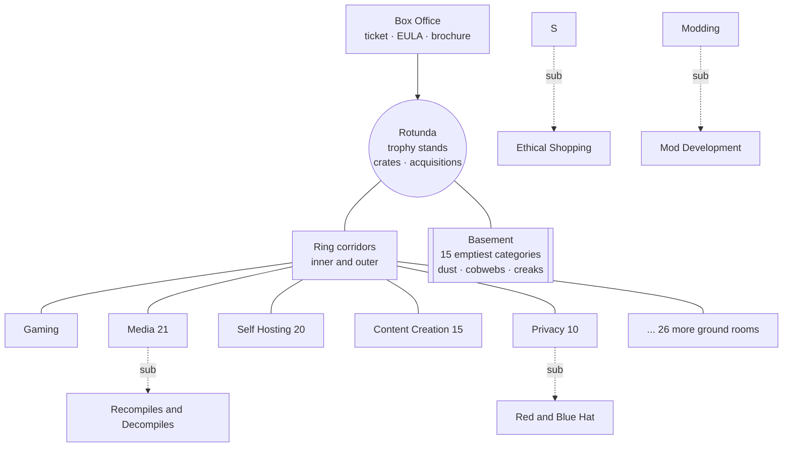

# Museum of Useful Links — v2 plan (locked)

Stop drawing one big room and start building a *building*: exhibit rooms around
a ring corridor, one per category, plus an empty central rotunda where future
links land. Real materials and lighting, a real computed star map outside the
windows, a guided tour that moves like Google Earth, footsteps with echo,
ambient events that never feel scripted.

The room count was re-cut on 2026-11-13 from twelve to **47** — see §10. The
twelve-room plan below is what is *built*; §10 is what it becomes next.

## Decisions, as locked

| Topic | Locked |
|---|---|
| Rooms | **47** as of 2026-11-13 (was 12). 43 categories + Charity + four sub-rooms entered through their parent. Tags exist *as well as* rooms, never instead of them. See §10. |
| Delivery | **One file, double-clickable.** three.js bundled in at build time (esbuild). No server, no CDN, no CORS problem. Source stays modular for editing. |
| Sky | Real computed sky. **One region dial for the whole building** — the regions are *not* rooms and this is not a world tour. Default **US-East (40.7 N, 74.0 W)**, i.e. the actual sky over you tonight, with the other six on the dial. True current time, plus an "always night" switch. |
| Audio | **No jukebox.** All sound is synthesised: footsteps with per-room echo, room tone, and event sound effects. Nothing from your music library. |
| Acquisitions board | In, low priority (~30 min): paste a URL, a crate appears in the rotunda, saved locally. |
| XR | Viewer rig with eye height + IPD now (free, it is the camera model anyway); a hidden "enter VR" button is the last item and can slip to the next step. |
| Sound default | On after your first click, with a level meter; `M` mutes. |
| Cost table | **Merged 2026-11-13.** 112 rows in, 192 exhibits out. 9 rows dropped as invented or duplicated (Strong, Movora, Monkey, Melon, Ethereal, Docker Desktop, Tdarr Agent, Kdenlive, Umanari), 13 wrong URLs corrected, 8 rows the owner supplied back-corrected. `scratch/merge-costs.mjs` is the one-pass record of every move. |
| Entry | **Ticket, then brochure.** Agreeing to the rules is the door. The brochure carries controls, the tour, the donation ask and the owner's socials. §10. |
| Trophy stands | Three in the main hall: sponsors, top donors over a threshold, own work as the fallback. One plaque explains the ladder. §10. |
| Basement | The fifteen categories with the fewest exhibits live downstairs, and a category with nothing in it is always downstairs until something arrives. Liminal: dust, cobwebs, creaks, backrooms light. §10. |
| Random / tour | Both pick a **room**, not an exhibit. ~50 rooms, not ~200 exhibits. §10. |

## 1 · Scale grid (what makes walk/VR support cheap later)

Every dimension is a named constant in one file, in metres.

| Constant | Value | Why |
|---|---|---|
| `EYE_H` | 1.65 m | average adult eye height; walk camera sits here |
| `EYE_MIN/MAX` | 1.35 / 1.85 m | seated + tall presets |
| `IPD` | 0.065 m | stereo separation, used by the XR rig |
| `DOOR_W` | 1.00 m | clear opening (0.90 m is the accessibility floor) |
| `DOOR_H` | 2.15 m | lintel height; nothing hangs lower in a doorway |
| `CORRIDOR_W` | 2.60 m | two people pass comfortably |
| `TURN_CIRCLE` | 1.50 m | minimum clear floor at every exhibit |
| `PLINTH_H` | 0.95 m | plaque at 1.1–1.4 m, tilted 30° |
| `CEIL` | 4.2 / 6.0 / 9.5 m | cabinet / gallery / rotunda drum |
| `ROOM_MIN` | 6 × 7 m | smallest room still fits 2 exhibits + turn circle |

The camera is a **viewer rig**: head position + eye height + IPD, with two
controller anchors. Orbit, walk and tour are three *drivers* of the same rig;
WebXR later swaps the driver, not the building.

## 2 · The twelve rooms

Room size scales with the number of exhibits, so Gaming is a long hall and
Linux/Fun are cabinets. Each has its own architecture and material set — never
a recoloured box.

| Room | Exhibits | Character |
|---|---|---|
| Gaming | 16 | long hall, concrete + cable tray, neon cove, CRT wall |
| Creative | 14 | atelier: north-lit clerestory, oak floor, easels, print wall |
| Media | 11 | screening rooms: dark carpet, velvet, a running projector |
| Privacy | 10 | the vault: brushed steel, glass vitrines, low light |
| Tools | 8 | instrument room: workbenches, dials, oscilloscope glow |
| Dev | 7 | scriptorium / print shop: type cases, monospace wall |
| Android | 6 | oak shelving, green glass, a small robot plinth |
| Shopping | 5 | customs house: marble counter, scales, keys |
| AI | 4 | the engine: dark hall, slow rotating lattice, cold rim light |
| Reading | 3 | two-storey library: galleries, ladder, warm lamps |
| Linux | 2 | server alcove: rack, blinking LEDs, cold air |
| Fun | 2 | cabinet of curiosities: cluttered vitrine, oddballs |
| **Rotunda** | **0** | domed centre, empty plinths, crates, dust sheets, acquisitions board |

## 3 · Appearance (priority 1)

- three.js **r160+**, bundled by esbuild into the single file.
- PBR materials + generated PMREM env map: chrome, brass, ivory, marble,
  painted plaster, oiled oak, brushed steel, glass.
- Real lights: hemisphere wash, warm key per room, coloured rim, practical
  lamps over the vitrines. Soft shadows where they pay.
- Post chain: `UnrealBloom` → optional `SSAO` → ACES tone mapping → custom
  pass (film grain, vignette, faint chromatic aberration; scanlines only in
  the tech-flavoured rooms).
- RTX 5090 here, so the ceiling is taste. The fps watchdog still drops bloom →
  SSAO → shadow resolution → star count, in that order, silently.

## 4 · The sky through the windows

Computed, not painted. One global region dial (default US-East), seven presets:
`US-East 40.7N 74.0W` · `US-Central 41.9N 87.6W` · `US-West 34.1N 118.2W` ·
`Europe-West 48.9N 2.3E` · `Europe-East 52.2N 21.0E` · `Oceania 33.9S 151.2E` ·
`Asia 35.7N 139.7E`.

- ~5,000-star catalogue (mag ≤ 6.5) with RA, Dec, magnitude, colour index —
  public-domain data, checked into the repo at build time (~120 KB).
- UTC + longitude → local sidereal time → alt/az. Constellation lines and
  labels fade in when the sky is dark.
- Planets (Mercury–Saturn) and the Moon with the correct phase and position.
- Milky Way along the true galactic plane, horizon haze, light-pollution glow,
  moon-wash.
- Windows are real openings with frames and sills and a little outside ground,
  so the sky has something to sit on. No exterior flyover.

## 5 · Moving through it

- **Guided tour:** `←` `→` and on-screen arrows step room → room on a short
  spline through the doorway, 0.9–1.4 s, ease-out, title card on crossing.
- **Mood shift per room:** fog colour/density, light temperature, bloom, dust,
  room tone and post-FX cross-fade with the move.
- **Random link** picks a random *room*, walks you there, then offers the
  exhibits inside it.
- **Walk mode:** WASD + mouse look at `EYE_H`, wall/door collision.

## 6 · Sound (no jukebox)

- Footsteps: filtered noise + low thud, variants per floor (marble, oak,
  carpet, concrete), scuff on turns, softer walking slowly.
- Echo: a procedurally generated impulse response per room, reverberation time
  derived from that room's actual volume. Rotunda rings, alcoves are dead.
- Room tone: HVAC hum, a distant door, a faint rack fan in Linux, paper-room
  stillness in the library.

## 7 · Ambient events

Types: door easing shut, light flickering in the next hall, a cart rolling
past, a shadow crossing a doorway, a lamp buzzing, a distant cough, a security
camera panning, a cloud-shadow sweeping the floor, a crate being dragged.

Anti-clustering (deterministic, unit-tested): shuffle bag so every type once
per bag; ≥ 25 s apart, jittered; never two during one move; **no peek-in event
twice in a row and never three of any type inside five**; no two events in the
same room within 90 s; ~6 per 10 minutes; nothing in the first 45 s.

## 8 · Build & checks

- `scratch/src/*` become ES modules; esbuild stitches three.js + addons + the
  museum into one `index.html`.
- Headless checks: every room reachable, no wall clipping on the tour path,
  star alt/az spot-checked against known values for tonight, event scheduler
  run 10,000 times against the anti-clustering rules, draw-call and fps
  budget, console clean, one screenshot per room.
- v1 tagged `v1-rotunda`, so nothing is lost.

## 9 · Phases and ETA

| # | Phase | Est. |
|---|---|---|
| 0 | esbuild pipeline, vendor three r160, tag v1, check harness for the new build | 1 h |
| 1 | materials, env map, lights, post chain, fps watchdog | 2 h |
| 2 | architecture: rotunda, ring corridor, 12 rooms, doors, windows, collision | 3.5 h |
| 3 | room theming + props, room by room | 4 h |
| 4 | sky: catalogue, sidereal maths, planets/moon, constellations, region dial | 3 h |
| 5 | navigation: viewer rig, walk, tour + arrows, random-room | 3 h |
| 6 | audio: footsteps, per-room IR, room tone, event SFX | 1.5 h |
| 7 | ambient event scheduler + tests | 1.5 h |
| 8 | checks, offline build, README, zip | 2 h |
| 9 | acquisitions board (optional), hidden XR button (optional) | 0.75 h |
| | **total** | **≈ 22 h** |

Milestones: **playable building** (0–2) in ~6.5 h, **full v2** in ~22 h,
checkpointed so every stopping point is a working site.

## 10 · Revision, 2026-11-13

The cost table merged into `src/data.js`: **192 exhibits, 47 rooms** — 31 rooms
with something in them, 16 still empty. `scratch/merge-costs.mjs` is the one
pass that did it and prints every move it makes.

**Taxonomy.** 43 categories plus Charity, plus four sub-rooms entered through
their parent rather than off a corridor: Red and Blue Hat off Privacy, Ethical
Shopping off Shopping, Mod Development off Modding, Recompiles and Decompiles
off Emulation and Re(de)omps. Tags exist *as well as* rooms, never instead of
them — the owner asked for the rooms even where a tag would be the tidier
answer. Cost prints on the plaque beside the wall-label text.

**The basement rule.** The fifteen categories with the fewest exhibits live
downstairs. A category with nothing in it is always downstairs until something
arrives. Once every category holds at least one exhibit, the rule is purely
numeric: the fifteen emptiest are the basement, and rooms swap when the counts
cross. The plan computes this from the data, so it re-shelves itself.

**The building changes shape.** Four ranges of three rooms cannot hold 31
ground-floor rooms. New plan: two concentric ring corridors around the rotunda
— sixteen rooms between the rings, nineteen beyond the outer one, each room a
radial wedge with its own doorway, windows and light anchors. The basement is a
grid under the rotunda, reached by one grand stair off the rotunda floor.

**Entry sequence.** The title screen becomes a ticket. The rules and disclaimer
are printed on it; agreeing to them *is* the door. Past it you get the brochure:
controls, the features (guided tour, random room, sky dial, mute), the donation
ask, and the owner's socials at the end. The same closing page runs at the end
of the curated tour.

**Trophy stands.** Three empty stands in the rotunda, with one plaque that
explains the ladder: company sponsors first, then top donors over a threshold,
then work the owner made or is actively sponsored in. Deliberately empty until
there is something to put on them.

**Basement feel.** Concrete, dead fluorescent tubes with one that tries to
start, dust sheets over the plinths, cobweb in the corners, motes in the light,
fog twice as thick as upstairs, floorboards and pipes that creak underfoot and
drip when you are not moving. Backrooms first, Luigi's Mansion second.

**Random and tour pick rooms, not exhibits.** `R` chooses a room and you find
the links inside it; the curated tour is a route through rooms, not through
plinths. That is ~50 choices instead of ~200, and it is what makes a 47-room
building tourable at all.

### Phases added by the revision

| # | Phase | Est. |
|---|---|---|
| 10 | plan rebuild: two rings, radial wedges, basement grid, stair, collision, walkability | 4 h |
| 11 | building rebuild: sub-rooms, basement materials, dust, cobwebs, flicker | 3 h |
| 12 | entry sequence: ticket, rules, brochure, closing page on the tour | 1.5 h |
| 13 | trophy stands and their plaque | 0.5 h |
| 14 | random-room and room-based tour, plus basement audio (creaks, drips) | 1.5 h |
| | **revised total** | **≈ 32.5 h** |
