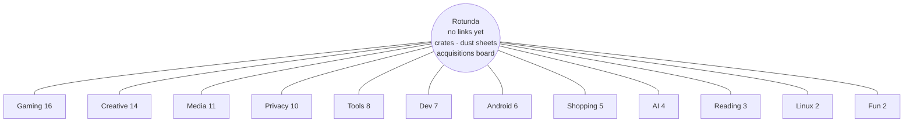

# Museum of Useful Links — v2 plan (locked)

Stop drawing one big room and start building a *building*: **12 exhibit rooms**
(one per category that already has links) around a ring corridor, plus **one
empty central rotunda** with no links yet. Real materials and lighting, a real
computed star map outside the windows, a guided tour that moves like Google
Earth, footsteps with echo, ambient events that never feel scripted.

## Decisions, as locked

| Topic | Locked |
|---|---|
| Rooms | **12** — exactly the categories that already have links, plus the empty rotunda. No finer sub-rooms. |
| Delivery | **One file, double-clickable.** three.js bundled in at build time (esbuild). No server, no CDN, no CORS problem. Source stays modular for editing. |
| Sky | Real computed sky. **One region dial for the whole building** — the regions are *not* rooms and this is not a world tour. Default **US-East (40.7 N, 74.0 W)**, i.e. the actual sky over you tonight, with the other six on the dial. True current time, plus an "always night" switch. |
| Audio | **No jukebox.** All sound is synthesised: footsteps with per-room echo, room tone, and event sound effects. Nothing from your music library. |
| Acquisitions board | In, low priority (~30 min): paste a URL, a crate appears in the rotunda, saved locally. |
| XR | Viewer rig with eye height + IPD now (free, it is the camera model anyway); a hidden "enter VR" button is the last item and can slip to the next step. |
| Sound default | On after your first click, with a level meter; `M` mutes. |
| Cost table | **Open, not merged.** A 110-row software cost table arrived 2026-11-12. Transcribed to `scratch/candidates-software-costs.js`; `node scratch/check-candidates.mjs` reports 4 collisions with the live collection, 8 rows whose domains do not exist, 9 whose domains belong to other products, and 13 real products with wrong URLs. Merging as-is puts 52 exhibits in the Atelier and 33 in the Print Shop, which the 12-room plan cannot hold at a 1.50 m turning circle. Awaiting: drop or keep the unverifiable rows, and whether the big rooms get split. See `HANDOFF.md`. |

## 1 · Scale grid (what makes walk/VR support cheap later)

Every dimension is a named constant in one file, in metres.

| Constant | Value | Why |
|---|---|---|
| `EYE_H` | 1.65 m | average adult eye height; walk camera sits here |
| `EYE_MIN/MAX` | 1.35 / 1.85 m | seated + tall presets |
| `IPD` | 0.065 m | stereo separation, used by the XR rig |
| `DOOR_W` | 1.00 m | clear opening (0.90 m is the accessibility floor) |
| `DOOR_H` | 2.15 m | lintel height; nothing hangs lower in a doorway |
| `CORRIDOR_W` | 2.60 m | two people pass comfortably |
| `TURN_CIRCLE` | 1.50 m | minimum clear floor at every exhibit |
| `PLINTH_H` | 0.95 m | plaque at 1.1–1.4 m, tilted 30° |
| `CEIL` | 4.2 / 6.0 / 9.5 m | cabinet / gallery / rotunda drum |
| `ROOM_MIN` | 6 × 7 m | smallest room still fits 2 exhibits + turn circle |

The camera is a **viewer rig**: head position + eye height + IPD, with two
controller anchors. Orbit, walk and tour are three *drivers* of the same rig;
WebXR later swaps the driver, not the building.

## 2 · The twelve rooms

Room size scales with the number of exhibits, so Gaming is a long hall and
Linux/Fun are cabinets. Each has its own architecture and material set — never
a recoloured box.

| Room | Exhibits | Character |
|---|---|---|
| Gaming | 16 | long hall, concrete + cable tray, neon cove, CRT wall |
| Creative | 14 | atelier: north-lit clerestory, oak floor, easels, print wall |
| Media | 11 | screening rooms: dark carpet, velvet, a running projector |
| Privacy | 10 | the vault: brushed steel, glass vitrines, low light |
| Tools | 8 | instrument room: workbenches, dials, oscilloscope glow |
| Dev | 7 | scriptorium / print shop: type cases, monospace wall |
| Android | 6 | oak shelving, green glass, a small robot plinth |
| Shopping | 5 | customs house: marble counter, scales, keys |
| AI | 4 | the engine: dark hall, slow rotating lattice, cold rim light |
| Reading | 3 | two-storey library: galleries, ladder, warm lamps |
| Linux | 2 | server alcove: rack, blinking LEDs, cold air |
| Fun | 2 | cabinet of curiosities: cluttered vitrine, oddballs |
| **Rotunda** | **0** | domed centre, empty plinths, crates, dust sheets, acquisitions board |

## 3 · Appearance (priority 1)

- three.js **r160+**, bundled by esbuild into the single file.
- PBR materials + generated PMREM env map: chrome, brass, ivory, marble,
  painted plaster, oiled oak, brushed steel, glass.
- Real lights: hemisphere wash, warm key per room, coloured rim, practical
  lamps over the vitrines. Soft shadows where they pay.
- Post chain: `UnrealBloom` → optional `SSAO` → ACES tone mapping → custom
  pass (film grain, vignette, faint chromatic aberration; scanlines only in
  the tech-flavoured rooms).
- RTX 5090 here, so the ceiling is taste. The fps watchdog still drops bloom →
  SSAO → shadow resolution → star count, in that order, silently.

## 4 · The sky through the windows

Computed, not painted. One global region dial (default US-East), seven presets:
`US-East 40.7N 74.0W` · `US-Central 41.9N 87.6W` · `US-West 34.1N 118.2W` ·
`Europe-West 48.9N 2.3E` · `Europe-East 52.2N 21.0E` · `Oceania 33.9S 151.2E` ·
`Asia 35.7N 139.7E`.

- ~5,000-star catalogue (mag ≤ 6.5) with RA, Dec, magnitude, colour index —
  public-domain data, checked into the repo at build time (~120 KB).
- UTC + longitude → local sidereal time → alt/az. Constellation lines and
  labels fade in when the sky is dark.
- Planets (Mercury–Saturn) and the Moon with the correct phase and position.
- Milky Way along the true galactic plane, horizon haze, light-pollution glow,
  moon-wash.
- Windows are real openings with frames and sills and a little outside ground,
  so the sky has something to sit on. No exterior flyover.

## 5 · Moving through it

- **Guided tour:** `←` `→` and on-screen arrows step room → room on a short
  spline through the doorway, 0.9–1.4 s, ease-out, title card on crossing.
- **Mood shift per room:** fog colour/density, light temperature, bloom, dust,
  room tone and post-FX cross-fade with the move.
- **Random link** picks a random *room*, walks you there, then offers the
  exhibits inside it.
- **Walk mode:** WASD + mouse look at `EYE_H`, wall/door collision.

## 6 · Sound (no jukebox)

- Footsteps: filtered noise + low thud, variants per floor (marble, oak,
  carpet, concrete), scuff on turns, softer walking slowly.
- Echo: a procedurally generated impulse response per room, reverberation time
  derived from that room's actual volume. Rotunda rings, alcoves are dead.
- Room tone: HVAC hum, a distant door, a faint rack fan in Linux, paper-room
  stillness in the library.

## 7 · Ambient events

Types: door easing shut, light flickering in the next hall, a cart rolling
past, a shadow crossing a doorway, a lamp buzzing, a distant cough, a security
camera panning, a cloud-shadow sweeping the floor, a crate being dragged.

Anti-clustering (deterministic, unit-tested): shuffle bag so every type once
per bag; ≥ 25 s apart, jittered; never two during one move; **no peek-in event
twice in a row and never three of any type inside five**; no two events in the
same room within 90 s; ~6 per 10 minutes; nothing in the first 45 s.

## 8 · Build & checks

- `scratch/src/*` become ES modules; esbuild stitches three.js + addons + the
  museum into one `index.html`.
- Headless checks: every room reachable, no wall clipping on the tour path,
  star alt/az spot-checked against known values for tonight, event scheduler
  run 10,000 times against the anti-clustering rules, draw-call and fps
  budget, console clean, one screenshot per room.
- v1 tagged `v1-rotunda`, so nothing is lost.

## 9 · Phases and ETA

| # | Phase | Est. |
|---|---|---|
| 0 | esbuild pipeline, vendor three r160, tag v1, check harness for the new build | 1 h |
| 1 | materials, env map, lights, post chain, fps watchdog | 2 h |
| 2 | architecture: rotunda, ring corridor, 12 rooms, doors, windows, collision | 3.5 h |
| 3 | room theming + props, room by room | 4 h |
| 4 | sky: catalogue, sidereal maths, planets/moon, constellations, region dial | 3 h |
| 5 | navigation: viewer rig, walk, tour + arrows, random-room | 3 h |
| 6 | audio: footsteps, per-room IR, room tone, event SFX | 1.5 h |
| 7 | ambient event scheduler + tests | 1.5 h |
| 8 | checks, offline build, README, zip | 2 h |
| 9 | acquisitions board (optional), hidden XR button (optional) | 0.75 h |
| | **total** | **≈ 22 h** |

Milestones: **playable building** (0–2) in ~6.5 h, **full v2** in ~22 h,
checkpointed so every stopping point is a working site.
